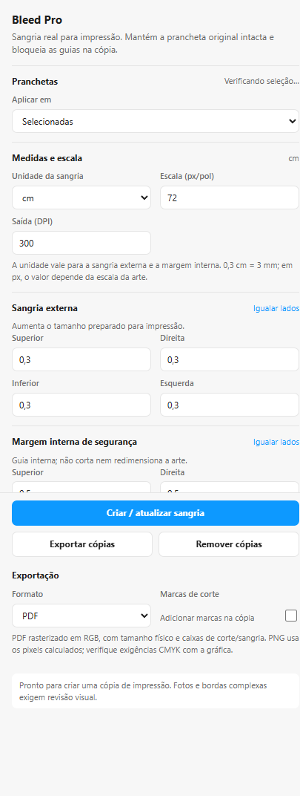

# Bleed Pro

Plugin do Figma para preparar cópias de impressão com sangria externa, margem interna de segurança, marcas de corte e exportação em PDF ou PNG.

## Baixar

1. Abra o repositório no GitHub: <https://github.com/StaineeX/figai.git>.
2. Clique em **Code → Download ZIP**.
3. Extraia o ZIP em uma pasta fácil de localizar.

Para baixar somente o plugin, use o pacote `Bleed-Pro-mm-cm.zip` quando ele estiver publicado em **Releases**.

## Instalar no Figma Desktop

1. Abra o Figma Desktop e um arquivo de design.
2. Abra **Plugins → Development → Import plugin from manifest…**.
3. Selecione `figma-plugins/bleed-pro/manifest.json` dentro da pasta extraída.
4. Execute **Bleed Pro** em **Plugins → Development**.

O plugin não precisa de servidor nem de acesso à internet.

## Usar

1. Selecione uma ou mais pranchetas (`Frame`) no canvas.
2. Em **Aplicar em**, escolha **Selecionadas** ou **Página atual**.
3. Em **Medidas e escala**, escolha a unidade da sangria e da margem: `mm`, `cm` ou `px`.
4. Informe a **Escala (px/pol)** da arte. Use `72` quando 72 px representam uma polegada; use a escala real da arte quando ela foi criada em outra resolução.
5. Informe a resolução de saída em **DPI**.
6. Preencha a **Sangria externa**. Ela aumenta a área preparada para impressão.
7. Preencha a **Margem interna de segurança**. Ela cria uma guia dentro do corte e não reduz nem corta a arte.
8. Ative **Marcas de corte** se a gráfica exigir essas marcas.
9. Clique em **Criar / atualizar sangria**.
10. Confira visualmente a cópia criada e clique em **Exportar cópias** para baixar PDF ou PNG.

A prancheta original permanece intacta. Para remover apenas as cópias geradas pelo plugin, clique em **Remover cópias**.

## Conversão das medidas

As medidas físicas são convertidas usando a escala da arte:

- `10 mm = 1 cm`;
- `3 mm = 0,3 cm`;
- em `px`, o valor depende da escala informada;
- em `300 px/pol`, `10 mm` correspondem a aproximadamente `118,11 px`.

Ao trocar a unidade na interface, os campos são convertidos sem alterar o tamanho físico configurado.

## Exportação e conferência

- Cada arquivo é baixado individualmente e confirmado antes do próximo download.
- O PDF inclui o tamanho da página, a sangria e as marcas configuradas.
- O PDF continua sendo rasterizado em RGB; a conversão CMYK e a aprovação final devem ser feitas conforme a exigência da gráfica.
- Revise fotos, textos e elementos que chegam até a borda: a extensão automática repete pixels das extremidades, mas não substitui uma revisão de arte.

## Problemas comuns

**O plugin não aparece:** confirme que está usando o Figma Desktop e que importou o `manifest.json` correto.

**A sangria ficou maior ou menor:** confira a unidade e a **Escala (px/pol)** antes de criar novamente.

**Não há nada para exportar:** crie ou atualize a cópia de impressão antes de clicar em **Exportar cópias**.

**A gráfica pediu CMYK:** exporte o arquivo e faça a conversão/preflight no fluxo de pré-impressão exigido pela gráfica.
